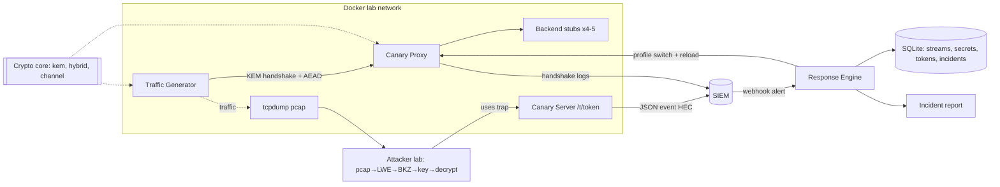

# IMPLEMENTATION_SPEC — Canary Q-Day

> Audience: Claude Code. This file is the single source of truth for scope, architecture and milestones.
> Do not invent major architectural decisions. If something is marked **OPEN**, stop and ask the human.

## 1. Objective and scope

**Academic goal (authoritative):** an in-depth study of **ML-KEM (Kyber, FIPS 203)** for an advanced-cryptography course, validated experimentally.

**Research question:** *How does the security of ML-KEM depend on its parameters, its implementation and its hybrid deployment, and how can a break be detected and its impact bounded?*

**System:** "Canary Q-Day" generates synthetic encrypted traffic at several crypto levels. Each stream carries a **trap** (fake credential pointing to a canary server). If an (simulated) attacker breaks the crypto, decrypts a stream and uses the trap, the canary server emits an event to a SIEM, which fires an alert, which triggers an automated, policy-gated **response** (stop the bleeding, neutralize exposed secrets, document).

**Weight:** ~70% study of Kyber (theory, own implementation, parameter/attack analysis, hybrid), ~30% canary/SOC application.

### Crypto levels (profiles)
| Profile | Meaning | Parameters | Expected in lab |
|---|---|---|---|
| `RED` | toy Module-LWE, Kyber-shaped | tiny (n,k) | **breakable** in the demo |
| `ORANGE` | toy, larger | intermediate (n,k) | breakable with more compute / timeout |
| `GREEN` | hybrid X-Wing (X25519 + ML-KEM-768) | FIPS 203 | **not** breakable (no attack attempted beyond guard) |

Toy parameters are **OPEN until calibrated** (milestone M3): they must be chosen with the lattice-estimator and verified empirically. Never hardcode guesses as facts.

### Explicit exclusions
- No production use of the from-scratch implementation. It is a study artefact.
- No attack on real systems or real traffic. The attacker module only works on toy profiles inside the lab network.
- No ZKP, PSI, vault, blockchain, ML-DSA/PKI (future work only).
- No claim that the canary detects *harvesting*. It only detects **decrypt-and-use** of synthetic traps (see §12 limitations).
- No real quantum computer; "Q-Day" is simulated by breaking toy parameters.

## 2. Decisions and open items
**Decided:** Python for the study implementation; Docker Compose lab with 4–5 stub services; SQLite registries; response policy gated by level (RED auto, ORANGE auto + notify, GREEN human only); dry-run by default; SIEM replaces Wazuh.
**OPEN (ask the human, do not guess):**
1. Final SIEM: default **Splunk Enterprise (trial/dev license)**; fallbacks Elastic Security, Microsoft Sentinel. Code must go through the `SiemSink` interface so the choice stays swappable.
2. Splunk native webhook cannot add custom headers (to verify in official docs) → webhook authentication mode (see §7.3).
3. Toy parameter sets (after M3 calibration).
4. Exact versions (pin at M0 after checking official docs; record in `docs/versions.md`).
5. Deadline and report language/format.

## 3. Architecture



### Trust zones
Z1 app lab (medium) · Z2 untrusted attacker/capture · Z3 observability (canary server is exposed to Z2 by design) · Z4 response + secrets (high). Secrets and KEM private keys live only in Z4/Docker secrets with mode 0600.

### Key lifecycle
generate (per profile, epoch n) → store (Docker secret, `key_id = SHA3-256(ek)`) → use (decaps per session; session key = HKDF(ss, info) ) → rotate (playbook, epoch n+1) → revoke (`key_id` flagged compromised, old profile refused) → destroy (delete secret; in-memory zeroization is best-effort in Python and must be documented as such).

### Main sequence
1. Generator picks a profile and a fresh stream; registers `stream_id, profile, key_id, epoch, started_at, services, secrets_issued` and a trap `token` in the registry.
2. Generator encapsulates to the proxy's static KEM public key → `ct`; both derive `K = HKDF-SHA256(ss, salt=empty, info="canary-qday/v1" || profile_id || H(transcript))`.
3. Payload (JSON with fake credentials + trap URL `http://canary/t/<token>`) is sent with ChaCha20-Poly1305 (nonce = 96-bit counter per direction). Capture records the pcap.
4. Attacker (lab) extracts the public instance, runs the lattice attack, recovers the secret key, decapsulates, decrypts, requests the trap URL.
5. Canary server logs a `trap_triggered` event → SIEM (HEC) → SPL alert → webhook → Response Engine.
6. Response Engine verifies authenticity + freshness, loads policy for the profile, computes exposure, executes actions (dry-run unless `--apply`), writes the report.

## 4. Components
Each component: purpose · I/O · deps · security · failure modes · tests · priority (P0 must, P1 should, P2 stretch).

| Component | Purpose | Inputs → Outputs | Security requirements | Failure modes | Tests | Prio |
|---|---|---|---|---|---|---|
| `kem` | ML-KEM from scratch + parametrizable toy profiles | params, seeds → ek, dk, ct, ss | FIPS 203 input checks; implicit rejection; no secret in logs; **documented NOT constant-time** | wrong encoding, FO bug, decryption failure in toy params | KAT/ACVP, property, differential vs liboqs, fuzz | P0 |
| `hybrid` | X-Wing (X25519+ML-KEM-768) + TLS-style combiner (comparison) | ek/dk (both) → ss | combiner binds ciphertexts and public keys per spec | wrong combiner order | spec vectors, property | P0 |
| `channel` | handshake, KDF, AEAD, framing | ct, profile → session | profile id bound in KDF; counters never reused; reject unknown profiles | nonce reuse, downgrade | tamper/replay/downgrade tests | P0 |
| `traffic` | stream generator, traps, registry | config → streams, tokens, secrets | tokens = 128-bit random; no real secrets | token collision | unit, integration | P0 |
| `services` | proxy, backend stubs, canary server | HTTP/TCP | canary server returns identical response for valid/invalid tokens | log injection, DoS | integration, security | P0 |
| `siem` | `SiemSink` interface; Splunk HEC; file sink; mock HEC | event → SIEM | HEC token from secret; TLS to HEC | SIEM down → events buffered on disk | contract tests with mock | P0 |
| `response` | webhook, policy, exposure, actions, report | alert → actions + report | auth + replay protection; dry-run default; idempotent; rate limited | forged alert, over-blocking | policy matrix, replay, forged, dry-run no side-effects | P0 |
| `lab/attacker` | lab-only attack tooling | pcap → key → trap use | `guard.py` refuses non-toy profiles and non-lab networks | misuse | guard tests | P0 |
| `experiments` | reproducible runners, plots | configs → CSV/JSONL + figures | seeds, env capture | non-reproducible runs | smoke runs in CI | P0 |
| `siem/splunk` | props, saved search, dashboard | — | no secrets committed | misconfig | manual checklist | P1 |

## 5. Cryptographic requirements
- ML-KEM: implement FIPS 203 (K-PKE, FO transform with implicit rejection, ByteEncode/Decode, compression, NTT, CBD, rejection sampling, SHA3/SHAKE via `hashlib`). Expose FIPS 203 **internal** functions (`KeyGen_internal(d,z)`, `Encaps_internal(ek,m)`, `Decaps_internal(dk,c)`) so ACVP vectors can be replayed. Sizes for ML-KEM-768: ek 1184 B, ct 1088 B, ss 32 B (assert in tests against FIPS 203 tables).
- Toy profiles: same structure (module-LWE over `R_q = Z_q[X]/(X^n+1)`, q=3329 kept, parameters `(n,k,η1,η2,du,dv)`), **schoolbook multiplication** (NTT not required for small n), same FO transform. Measure decryption-failure rate (DFR) empirically; reject parameter sets with DFR above a documented threshold.
- Hybrid: X-Wing per its specification (CFRG draft, **verify current status/vectors**), plus a TLS-style `X25519MLKEM768` combiner for comparison only.
- AEAD: ChaCha20-Poly1305 (RFC 8439) via `cryptography`. KDF: HKDF-SHA256 (RFC 5869). Randomness: `os.urandom`/`secrets` only; deterministic seeds only in tests/KAT.
- No custom primitives beyond ML-KEM/toy-Kyber (the research objective). Everything else uses `cryptography`.
- Replay/downgrade: profile id bound in HKDF `info` and transcript hash; server allow-list of profiles per epoch.
- Serialization: FIPS 203 encodings for KEM objects; length-prefixed frames with a version byte; events as UTF-8 JSON with sorted keys.
- Side channels: own Python code makes **no** constant-time claim. Constant-time evaluation (dudect) targets reference C/Rust builds (stretch S1).

## 6. Technology stack
**Mandatory:** Python 3.12 · `cryptography` · `pytest`, `pytest-cov`, `hypothesis` · `ruff`, `mypy --strict` · `bandit`, `pip-audit`, `gitleaks` · `liboqs`/`liboqs-python` (reference, differential tests) · `fpylll`/`fplll` (attack) · `lattice-estimator` (Sage, in a separate container) · `scapy` + `tcpdump` · `FastAPI`, `uvicorn`, `httpx` · SQLite · Docker + Docker Compose · GitHub Actions · `pandas`, `matplotlib` · Splunk Enterprise (container) with HEC.
**Optional:** `atheris` (fuzz) · `cyclonedx-py` (SBOM) · G6K (stronger sieving, S-level) · Rust port / dudect (stretch) · Elastic/Sentinel adapters.
Pin every dependency (hashes where possible). Do not use a version younger than ~2 weeks without checking its release notes. **Record verification in `docs/versions.md`.**

## 7. Interfaces

### 7.1 Event schema (canary → SIEM)
```json
{"event":"trap_triggered","event_id":"uuid","ts":"RFC3339","token_id":"hex8","stream_id":"uuid",
 "profile":"RED","params_id":"toy-n64-k2","key_id":"hex16","epoch":3,
 "src_ip":"...","user_agent":"..."}
```
Never log the full token, keys, or plaintext. Log `token_id` (truncated hash) only.

### 7.2 Response Engine API
| Endpoint | Purpose | Auth | Errors |
|---|---|---|---|
| `POST /v1/alerts` | receive SIEM alert | see 7.3 | `E_SIG_INVALID` 401, `E_STALE` 400, `E_REPLAY` 409, `E_SCHEMA` 422 |
| `POST /v1/approvals/{incident_id}` | human approves heavy actions | local admin token | `E_NOT_FOUND` 404, `E_POLICY` 403 |
| `GET /v1/incidents/{id}` | status + report | local admin token | `E_NOT_FOUND` 404 |

### 7.3 Webhook authentication (**OPEN**)
Interface `AlertAuthenticator` with two implementations: `HmacHeader` (`X-Signature` = HMAC-SHA256(secret, ts || body), `X-Timestamp`, nonce cache, ±120 s window) and `SharedSecretPath` (secret token in URL path + network isolation) for Splunk's native webhook if it cannot sign. Decide after checking Splunk documentation; fallback: custom alert action.

### 7.4 Response policy
| Profile | Automatic | Needs approval | Notes |
|---|---|---|---|
| RED | classify, switch to stronger profile, rotate secrets in window, report | firewall block, service stop | auto only if trap token valid and not allow-listed |
| ORANGE | classify, switch profile, rotate secrets, report + notify analyst | firewall block, service stop | |
| GREEN | create incident + report skeleton only | everything | crisis path, human decision |
Rules: dry-run by default (`--apply` to execute); idempotent; rate-limited; actions logged; heavy actions never automatic outside `--auto-lab`.

### 7.5 Exposure computation
Registry rows: `stream_id, profile, params_id, key_id, epoch, started_at, ended_at, services, secrets_issued`. Output two sets: **key-level exposure** (same `key_id`) and **algorithmic exposure** (same `params_id`, since an attacker can repeat the attack on other keys). Secrets prioritised by `sensitivity × remaining_lifetime`; already-expired secrets skipped. The past cannot be fixed: the report states what is lost (data already copied) vs what can be neutralised (secrets, future traffic).

## 8. Repository structure
```
canary-qday/
├─ CLAUDE.md  IMPLEMENTATION_SPEC.md  README.md  pyproject.toml  Makefile  docker-compose.yml
├─ .github/workflows/ci.yml
├─ docker/ (Dockerfile.app, Dockerfile.attacker, Dockerfile.estimator)
├─ src/canary_qday/
│  ├─ kem/      params.py field.py poly.py ntt.py sampling.py codec.py kpke.py kem.py profiles.py
│  ├─ hybrid/   xwing.py tls_combiner.py
│  ├─ channel/  kdf.py aead.py framing.py handshake.py
│  ├─ traffic/  generator.py traps.py registry.py
│  ├─ services/ proxy.py backend_stub.py canary_server.py
│  ├─ siem/     base.py splunk_hec.py file_sink.py schemas.py
│  ├─ response/ webhook.py auth.py policy.py exposure.py actions.py report.py
│  └─ common/   config.py logging.py redact.py errors.py
├─ lab/attacker/ guard.py pcap_extract.py lwe_embed.py bkz_attack.py decrypt_and_trigger.py
├─ experiments/ configs/ runners/ plots/ results/(gitignored)
├─ siem/splunk/ props.conf savedsearches.conf dashboards/ README.md
├─ tests/ unit/ property/ kat/ integration/ e2e/ security/
├─ vectors/ (ACVP/KAT files + README with provenance and checksums)
└─ docs/ architecture.md threat-model.md versions.md calibration.md report/
```
**Dependency rules:** `kem` imports only stdlib. `hybrid` → `kem`. `channel` → `kem`, `hybrid`. `traffic`, `services` → `channel`. `response` → `siem`, `common` (never `kem`). `lab/attacker` may import `kem.params/profiles` only and is never imported by `src/`. Test-only code stays in `tests/`; experimental code in `experiments/`.

## 9. Requirements (IDs, acceptance, verification)

| ID | Requirement | Prio | Acceptance criteria | Verify |
|---|---|---|---|---|
| FR-001 | ML-KEM-512/768/1024 per FIPS 203 | P0 | 100% of ACVP/KAT vectors pass; sizes match FIPS 203 | pytest kat |
| FR-002 | Interop with reference | P0 | 1000 cross encaps/decaps with liboqs per parameter set, 0 mismatch | integration |
| FR-003 | Toy profiles with schoolbook multiplication | P0 | Correct decryption rate ≥ documented threshold; DFR measured | experiment E4 |
| FR-004 | X-Wing hybrid | P0 | spec vectors pass; both-component tamper → different/failed ss | pytest |
| FR-005 | Secure channel | P0 | tampered/replayed/downgraded frames rejected; profile bound in KDF | security tests |
| FR-006 | Trap generation + registry | P0 | each stream has unique trap; registry queryable by profile/key/epoch | unit |
| FR-007 | Canary server emits events | P0 | valid and invalid tokens return identical responses; valid → event | integration |
| FR-008 | SIEM ingestion + alert | P0 | event visible in SIEM and alert fires ≤ 60 s (mock: ≤ 5 s) | e2e |
| FR-009 | Response engine per policy matrix | P0 | all 3×actions matrix cases behave per §7.4 | policy tests |
| FR-010 | Exposure computation | P0 | key-level and algorithmic sets match ground truth on synthetic registries | unit |
| FR-011 | Secret rotation | P0 | secrets in window revoked and replaced; expired ones skipped; idempotent | unit |
| FR-012 | Incident report | P0 | contains profile, window, exposed streams, actions, what is irrecoverable | snapshot |
| FR-013 | Lab attacker recovers toy key | P0 | succeeds on RED within timeout on ≥ 90% of instances (calibrated) | experiment E3 |
| FR-014 | One-command demo | P1 | `make demo` runs the full chain with mock SIEM | e2e |
| SEC-001 | Webhook authenticated, replay-protected | P0 | forged/replayed alert rejected, no action taken | security |
| SEC-002 | Dry-run default, no side effects | P0 | dry-run leaves registry/config byte-identical | security |
| SEC-003 | Attacker guard | P0 | refuses GREEN/standard params and non-lab hosts | security |
| SEC-004 | No secrets in repo/logs | P0 | gitleaks clean; log-redaction test passes | CI |
| SEC-005 | Input validation for ek/ct/frames | P0 | malformed inputs rejected without exception leaks; fuzz 1e5 inputs no crash | fuzz |
| SEC-006 | Key files 0600, secrets via Docker secrets | P0 | startup check fails otherwise | integration |
| SEC-007 | Rate limiting on response engine | P1 | burst of N alerts does not trigger N rotations | security |
| NFR-001 | Reproducible environment | P0 | `make setup && make test` works from clean clone in Docker | CI |
| NFR-002 | Type/lint clean | P0 | `mypy --strict`, `ruff` zero errors | CI |
| NFR-003 | Coverage | P0 | ≥ 90% on `kem`, `channel`, `response`; ≥ 80% overall | CI |
| NFR-004 | Deterministic experiments | P0 | fixed seeds; reruns produce same non-timing outputs | experiments |
| NFR-005 | Detection+response latency measured | P1 | E6 reports median/p95 | experiment |
| EXP-001…EXP-007 | See §11 | P0 | each experiment has config, runner, raw data, figure | experiments |

## 10. Testing strategy
Unit; property-based (`hypothesis`): `decaps(encaps(ek)) == ss`, tampered `ct` → different `ss` (implicit rejection), codec round-trips, NTT round-trip; known-answer tests from official vectors (store provenance + SHA-256 in `vectors/README.md`; **never fabricate vectors**); differential/interop vs liboqs; fuzz (malformed ek/ct/frames/webhooks); negative tests (wrong lengths, non-canonical encodings, replay, bad signature, unknown profile); integration (compose lab, mock SIEM); e2e (trap → alert → response → report); security tests per threat table; regression tests for every bug. Passing tests is **not** evidence of cryptographic security; the report must say so.

## 11. Experiments
| ID | Question | Method | Metrics |
|---|---|---|---|
| E1 | Correctness | ACVP/KAT + 1000 interop/param set | pass rate |
| E2 | Cost of own impl vs reference | keygen/encaps/decaps, 1000 runs after warm-up, same param sets | median, IQR, ratio; sizes in bytes |
| E3 | **Attack cost vs parameters (core)** | family of toy `(n,k)`; ≥ 30 random instances each; primal uSVP embedding + BKZ with progressive block size; timeout | success rate, time, BKZ block size β; compare with lattice-estimator prediction; log-time regression with bootstrap CI |
| E4 | Decryption failure rate | empirical DFR on toy params; analytical estimate for standard params (not measurable) | DFR |
| E5 | Hybrid overhead | X25519 / ML-KEM-768 / X-Wing / TLS-style combiner in own channel, 1000 handshakes | bytes, time |
| E6 | Detection & response latency | trap use → event → alert → response, N ≥ 30, dry-run and apply | median, p95 per stage |
| E7 | False positives | benign scans against canary server vs correlation rule | FP rate |
| S1 (stretch) | Constant-time of reference builds | dudect on liboqs/mlkem-native builds | t-statistics |
Automation: `make exp E=e3`; outputs `experiments/results/<id>/<timestamp>/{config.yaml,raw.jsonl,env.json,summary.csv,fig.png}`; `env.json` records CPU, OS, versions, seeds. **Never write conclusions before data exists.** Threats to validity (must be in report): toy ≠ standard regime; small-dimension deviation from estimator assumptions; primal attack only; Python timings not representative; single machine.

## 12. Limitations to state explicitly
1. The canary does **not** detect passive harvesting (undetectable by design). It detects **decrypt-and-use** of synthetic traps only; a careful attacker may ignore traps.
2. Synthetic traffic only says something about the crypto class, not about whether real traffic was captured.
3. Own implementation is for study; level GREEN in any realistic deployment should use a reviewed library.
4. No novelty claim without a proper literature search (one non-exhaustive search found no equivalent; verify).

## 13. DevSecOps
Branching: `main` protected; feature branches `feat/Mx-name`; Conventional Commits. Dependencies pinned with hashes. CI stages: (1) lint+types, (2) unit+property+KAT, (3) integration (compose, mock SIEM), (4) security: `bandit`, `pip-audit`, `gitleaks`, SBOM, (5) smoke experiments. **Blocking:** any stage failure, coverage below NFR-003, gitleaks finding, high/critical `pip-audit` finding. Secrets: `.env` untracked, `.env.example` committed, Docker secrets for keys and HEC token. Logs never contain keys, tokens, plaintext.

Commands (contract; implement in `Makefile`): `make setup`, `make lint`, `make test`, `make kat`, `make fuzz`, `make lab-up`, `make lab-down`, `make demo`, `make exp E=e3`, `make audit`, `make report`.

## 14. Milestones (execute in order; stop for human review at each gate)
Each milestone: run tests, inspect `git diff`, report results, **wait for approval** before the next (mandatory for M1–M3, M7, M8).

| M | Goal | Create/modify | Key tasks | Tests / checks | Acceptance (gate) |
|---|---|---|---|---|---|
| M0 | Foundations | repo skeleton, `pyproject.toml`, `Makefile`, CI, Dockerfiles, `docs/versions.md` | pin deps after checking official docs; pre-commit; empty packages with `py.typed` | `make lint test` on empty suite | CI green from clean clone |
| M1 | Primitives | `kem/params,field,poly,ntt,sampling,codec` | Z_q arithmetic, NTT/invNTT, CBD, rejection sampling, ByteEncode/Decode, compress | unit + property (round-trips) | all primitives tested; NTT round-trip |
| M2 | ML-KEM | `kem/kpke,kem`, `vectors/` | K-PKE, FO transform, implicit rejection, internal functions, input checks | KAT/ACVP, interop with liboqs, property, fuzz | FR-001, FR-002 |
| M3 | Toy profiles + calibration | `kem/profiles`, `docs/calibration.md`, `experiments/runners/e4` | schoolbook multiplication, DFR harness, run lattice-estimator, propose param sets | DFR measurements | parameters chosen **by data**, documented; human approves |
| M4 | Hybrid + channel | `hybrid/*`, `channel/*` | X-Wing, TLS-style combiner, HKDF, AEAD, framing, profile binding | vectors, tamper/replay/downgrade tests | FR-004, FR-005 |
| M5 | Traffic + traps + lab | `traffic/*`, `services/*`, `docker-compose.yml` | generator, registry, proxy, stubs, canary server, tcpdump container | integration: pcap contains handshake | FR-006, FR-007 |
| M6 | SIEM | `siem/*`, `siem/splunk/*` | `SiemSink`, HEC sink, file sink, mock HEC, props/saved search/dashboard | contract tests; manual Splunk checklist | FR-008 (mock); Splunk checklist done |
| M7 | Response engine | `response/*` | auth, policy matrix, exposure, actions, rotation, report; dry-run default | policy, replay, forged, dry-run tests | FR-009…012, SEC-001/002 |
| M8 | Attacker lab | `lab/attacker/*` | pcap extraction, embedding, BKZ, decrypt, trigger, guard | tiny-instance deterministic test; guard tests | FR-013, SEC-003 |
| M9 | End-to-end | `make demo`, e2e tests | scripted scenario with timestamps | e2e (mock SIEM) | FR-014 |
| M10 | Experiments | `experiments/*` | runners E1–E7, storage, plots, stats | smoke runs | EXP-001…007 reproducible |
| M11 | Hardening | CI, `tests/security`, fuzz | bandit, pip-audit, gitleaks, SBOM, redaction, permissions | all CI stages | no blocking findings |
| M12 | Docs + demo | `README.md`, `docs/*`, report skeleton, demo script | traceability matrix, limitations, slides outline | doc review | final DoD |
Common failure modes: fplll build problems (use the attacker image), toy params too weak/strong (recalibrate), Splunk license/alerting limits (use trial/dev license; Free has no alerting — verify), flaky timing tests (never assert wall-clock in unit tests).

## 15. Final definition of done
All P0 requirements pass; CI green; experiments E1–E7 reproducible with stored raw data; threat table mapped to tests; report contains theory, implementation, experiments and explicit limitations; demo runs with one command; no secrets in history; every claim in the report traceable to a test, experiment or cited source.
