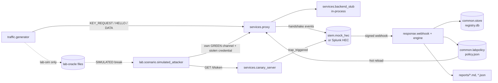

# Architecture

Spec reference: `IMPLEMENTATION_SPEC.md` §3–§8. This page describes what is **implemented** in this repository.

## Flow



Dotted edges are the simulated part (see `docs/m8-status.md`).

## Components

| Package | Responsibility | Depends on |
|---|---|---|
| `kem` | ML-KEM-512/768/1024 (FIPS 203) and toy profiles; `profiles.public_instance` exposes the public LWE form of a toy key | stdlib only |
| `hybrid` | X-Wing (draft-11); TLS-style combiner kept for comparison | `kem`, `cryptography` |
| `channel` | frames (`len ‖ version ‖ type ‖ payload`, max 64 KiB), handshake, HKDF-SHA256 key schedule, ChaCha20-Poly1305 records | `kem`, `hybrid` |
| `traffic` | trap tokens (128-bit), fake credentials (`FAKE-…`), stream registration, generator, lab oracle | `channel`, `common` |
| `services` | proxy (KEM termination, policy hot-reload, key manager), backend stubs, canary server | `channel`, `common`, `siem` |
| `siem` | `SiemSink` protocol, file sink, Splunk HEC sink, mock SIEM, schemas | `common` |
| `response` | webhook API, authenticators, policy matrix, exposure, actions, report, incident DB | `siem`, `common` (never `kem`) |
| `common` | errors, config and secret files, JSON logging with redaction, registry DAO, lab policy file, HMAC helper | stdlib, `pydantic` |
| `lab/attacker/guard.py` | lab-only guard (CQ_LAB=1, toy profiles, lab hosts) | `kem.profiles` |
| `lab/scenario` | simulated attacker scenario | everything above (lab code, never imported by `src`) |
| `tools/` | task runner, local lab process manager, vector checker | — |

## Protocol

```
C → S  KEY_REQUEST  profile_id
S → C  KEY_RESPONSE profile_id, epoch, key_id = SHA3-256(ek)[:8], ek
C → S  HELLO        profile_id, epoch, key_id, stream_id, ct
       transcript T = SHA-256 over length-prefixed (HELLO header, ek, ct)
       (K_c2s, K_s2c) = HKDF-SHA256(ss, salt = ∅, info = "canary-qday/v1" ‖ profile_id ‖ T)
C ↔ S  DATA         seq (u64), ChaCha20-Poly1305(K_dir, nonce = 0^32 ‖ seq, aad = header ‖ T ‖ seq)
```

The server rejects:
- profiles that are not on the allow-list;
- a `key_id` or epoch that is not current;
- revoked keys;
- a replayed HELLO (transcript cache);
- out-of-order or replayed DATA records (strict sequence).

## Trust zones and secrets

| Data | Where | Protection |
|---|---|---|
| KEM private keys | `<data>/secrets/<profile>-e<epoch>.dk` | written 0600, refused if more permissive (POSIX only; skipped on Windows) |
| Lab secrets (HEC token, webhook secret, admin token) | `<data>/secrets/*.txt`, passed as `*_FILE` | generated by `tools/lab.py`, never logged |
| Fake credentials | sent only inside the encrypted channel | registry stores SHA-256 only |
| Trap tokens | sent only inside the encrypted channel | registry stores SHA-256; logs and events carry `token_id` (8 hex chars) |
| Lab oracle | `<data>/lab-oracle/*.json` (0600) | only with `CQ_LAB_SIM=1`, only RED/ORANGE |

## Response engine

1. Authenticate the request (`HmacHeader` or `SharedSecretPath`), validate the schema strictly (unknown fields are rejected), check freshness, then rate-limit (30 alerts/min).
2. Deduplicate by `alert_id` (`E_REPLAY`).
3. Cross-check the alert against the registry. A token, stream, key, profile or params mismatch gives "unverified-token", and nothing runs automatically.
4. Apply the policy matrix (spec §7.4). Heavy actions wait for `POST /v1/approvals/{id}`.
5. Compute exposure:
   - key-level: same `key_id`;
   - algorithmic: same `params_id`;
   - rotation order: key-level first, then sensitivity × remaining lifetime; expired secrets are skipped.
6. Run the actions. In dry-run they only describe; registry and policy are not written. Rate scope: one run per (action, params_id, dry/apply) per 300 s.
7. Write the report (JSON and Markdown), with "Irrecoverable" and "Neutralised" sections.
